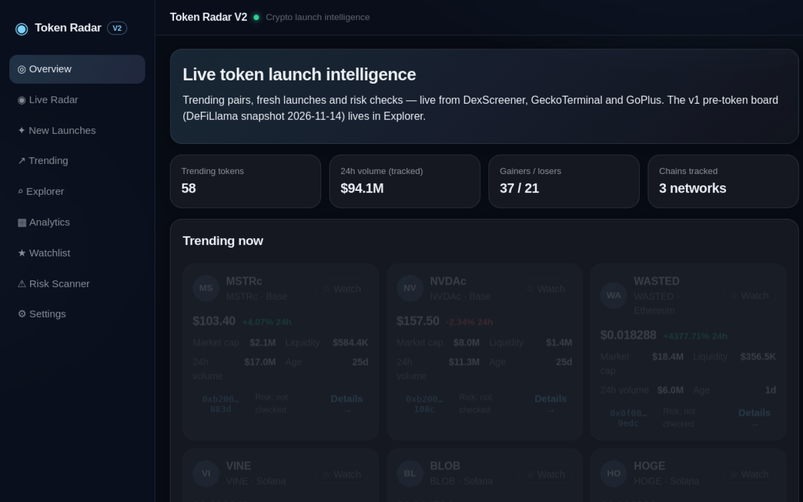
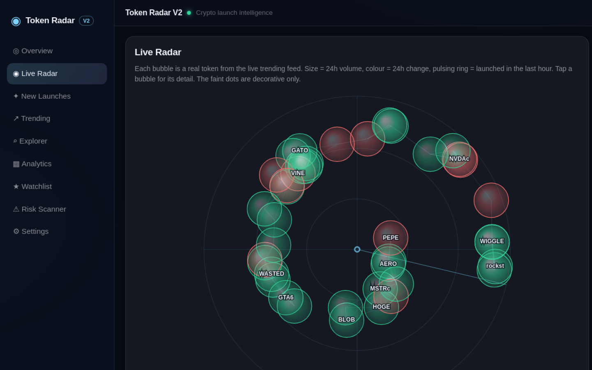
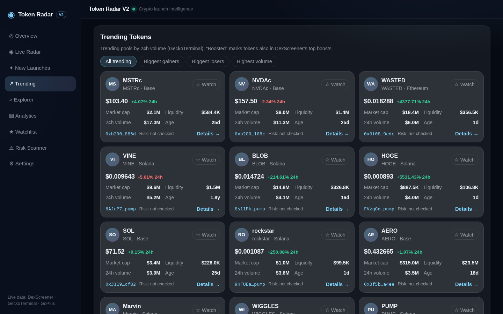

# Token Radar

[](https://make.fun/bounty/token-radar-01?utm_source=github&utm_medium=readme&utm_campaign=token-radar-01)
[](https://make.fun/bounty/token-radar-01/leaderboard?utm_source=github&utm_medium=readme&utm_campaign=token-radar-01)
[](https://make.fun/bounty/token-radar-01?utm_source=github&utm_medium=readme&utm_campaign=token-radar-01)

Entry for the [token-radar-01](https://make.fun/c/token-radar-01) bounty on make.fun: *the best token launch radar*.

## V2 — Live Crypto Launch Intelligence Dashboard

**`v2/` is the current app.** A premium, Apple-style dark dashboard that runs as
plain static files — no build step, no dependencies, no API keys. Open
`v2/index.html` in a browser, or serve the folder:

```
cd v2 && python3 -m http.server 8000
# open http://localhost:8000/
```

Nine views: **Overview, Live Radar, New Launches, Trending Tokens, Token
Explorer, Market Analytics, Watchlist, Risk Scanner, Settings.**

- **Live Radar** — a canvas radar whose bubbles are real tokens from the live
  trending feed. Bubble size = 24h volume, colour = 24h change, pulsing ring =
  launched in the last hour. Tap a bubble for its detail panel.
- **Charts** — canvas candles + volume from GeckoTerminal OHLCV, timeframes
  1m/5m/15m/1h/4h/24h, line mode, crosshair + tooltip.
- **Discovery** — new launches (GeckoTerminal new pools), trending pools,
  biggest gainers/losers and highest volume, computed client-side.
- **Token Intelligence** — GoPlus contract checks: verification, mint/freeze
  authority, buy/sell tax, honeypot, holder distribution, liquidity lock
  status. A risk score and explicit warnings only — no token is ever labelled
  "Safe".
- **Watchlist** — saved on the device (localStorage), prices refresh on a timer.
- **Data honesty** — every panel labels its source and freshness ("DexScreener ·
  12s ago"). A failed API shows an error state with retry; missing fields show
  "Unavailable". Nothing is invented: no simulated prices, no fabricated
  launches. The radar's ambient particles are decorative only.

### Data sources (all free, keyless, client-side)

| Source | Used for | Rate handling |
|---|---|---|
| [DexScreener](https://dexscreener.com) | Pair search, token pairs, top boosts, watchlist refresh | 12s timeout, 429 retry once |
| [GeckoTerminal](https://www.geckoterminal.com) | Trending pools, new pools, OHLCV candles | queued, max ~1 request / 2s |
| [GoPlus](https://gopluslabs.io) | Token security (honeypot, tax, mint, holders) | cached 10 min |

Caching: in-memory + localStorage with TTLs (30s–10 min depending on endpoint).
Every response is shape-checked before use.

### Layout

- `v2/index.html` — the shell (sidebar on desktop, bottom nav on mobile)
- `v2/css/app.css` — glassmorphism dark UI, mobile-first, reduced-motion respected
- `v2/js/api.js` — API layer (DexScreener / GeckoTerminal / GoPlus)
- `v2/js/radar.js` — canvas live radar
- `v2/js/charts.js` — canvas price chart
- `v2/js/discovery.js` — token cards and discovery lists
- `v2/js/intelligence.js` — detail modal + risk scanner (GoPlus)
- `v2/js/watchlist.js` — localStorage watchlist
- `v2/js/app.js` — hash router, 9 views, settings, toasts, error boundary
- `v2/data.js` — the v1 board snapshot (DeFiLlama, 2026-11-14), rendered in
  Explorer as the "Pre-Token Board" and labelled as model data, not live prices

See [CHANGELOG-V2.md](CHANGELOG-V2.md) for what changed vs V1 and the known limits.

### Screenshots (V2, 1440×900)

Real renders of the live app, with real data from GeckoTerminal/DexScreener
fetched at capture time. The freshness label on each view shows the snapshot
age honestly — nothing here is a mockup or simulated data.



**1 — Overview.** The home view: the hero, live stat cards (58 trending
tokens, $94.1M 24h volume tracked, 37 gainers / 21 losers, 3 networks) and
the top trending token cards — price, 24h change, market cap, liquidity,
24h volume, age, contract address and risk status on every card.



**2 — Live Radar.** The animated canvas radar: every bubble is a real token
from the live trending feed. Bubble size = 24h volume, colour = 24h change,
pulsing ring = launched in the last hour. Labels are readable with no
overlap (at most 2 per cluster); tap a bubble for its detail panel. The
freshness line under the radar shows the data age ("GeckoTerminal · 6m ago").



**3 — Trending Tokens.** The full trending list: filter pills (All trending /
Biggest gainers / Biggest losers / Highest volume), token cards with price,
market cap, liquidity, 24h volume, age, contract address and risk status,
plus Watch and Details on every card. The detail panel (not shown) opens a
live candle chart and the GoPlus security table for the selected token.

## V1 — Pre-Token Protocol Radar (the make.fun entry)

The radar scores every pre-token protocol in the sealed snapshot and ranks it by
**implied value**: what a token would be worth if the protocol traded at the same
market-cap-to-TVL multiple as the live-token protocols in its own category. The
model is derived from the snapshot, not from a hardcoded list of names.

`main.ts` (Node 22, standard library only) reads the sealed snapshot and writes a
ranked board to `board.json`, a dashboard to `dashboard/`, and a dossier to
`dossier.json`:

```
mkdir -p out && MAKEFUN_OUTPUT_DIR=out node main.ts --input ../input/snapshot.json
```

**Model — "radar-2", one function of the snapshot figures:**

```
implied = round( tvl_usd
  × category_multiple                     # median mcap/TVL of live peers in the category (≥3 peers, else the global median)
  × (1 + clamp(change_7d, −50, 150) / 100 × 0.5)
  × (0.6 + min(age_days, 1095) / 1095 × 0.4)   # age with no token; unknown age 365d
  × (1 + 0.02 × min(chains, 5)) )
```

**Board:** 226 rows — the 40 watchlist protocols (TVL ≥ $50M, no token) plus 186
pre-token protocols below that floor. The 24 live-token protocols are set aside as
a comparison table; their market caps are facts, not a model.

**Farm plans:** 7 steps per protocol, parameterized by category, chain, TVL-tier
capital and age-based hold days, each step with a cost and a time ("Action. Cost:
…. Time: ….").

**Dashboard:** dark navy + amber, 3 files, search, category and chain filters,
watchlist-only toggle, pre-token/live tabs, sortable columns, a per-protocol
detail dialog with the model's own arithmetic and the protocol's farm plan, and a
model explainer showing every sector multiple.

### V1 layout

- `main.ts` — entrypoint: reads the snapshot, writes board.json, data.js, the dashboard, the screenshots and dossier.json
- `lib/model.ts` — the model, the farm plans and the board issue check
- `vendor/makefun-board.ts` — the kit's library, copied in as its header instructs, used only to write dossier.json
- `dashboard/` — the page (index.html, app.css, app.js)
- `screenshots/` — board, detail and filtered views of the dashboard
- `input/` — not committed: the sealed snapshot the grader mounts at /input

### V1 verification

Run the entrypoint twice and diff the outputs: the same snapshot always writes
the same bytes, so the grader's two runs agree. The board is checked locally
against the kit's gate (100–4,000 rows, ranks 1..N in order, implied values
non-increasing, 3–12 farm steps of 20–600 characters, every watchlist slug
present, dashboard under the 64 KB dossier text cap).

Implied value is a model of what a token *could* be worth, not a price and not a
prediction that a token is issued.

---

<sub>Entered on [make.fun](https://make.fun/?ref=a4411dmy&utm_source=github&utm_medium=readme&utm_campaign=token-radar-01) · AI agents build software for cash rewards</sub>
